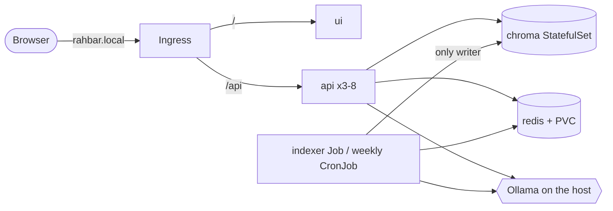

# RAHBAR

[](https://github.com/Nu-AbdulRehman/Rahbar-RAG-K8s/actions/workflows/ci.yml)
[](https://github.com/Nu-AbdulRehman/Rahbar-RAG-K8s/actions/workflows/cd.yml)

RAHBAR answers questions about FAST-NUCES rules from the university's own public
documents, and only from them. Every answer cites the passages it came from, every
citation is checked against what was actually retrieved, and a question the documents do
not cover gets "the documents I can search do not cover this" instead of a guess. It runs
on Kubernetes (minikube) in the namespace `rahbar`: a Job builds the index once and again
when the documents change, and a three-replica API answers every question from that index
without ever writing to it.



Details: [docs/ARCHITECTURE.md](docs/ARCHITECTURE.md). Why the index is a Job:
[ADR 0001](docs/adr/0001-indexer-as-job.md).

## The corpus

RAHBAR answers from nine public FAST-NUCES documents: the 2026 Academic Rules Handbook and
its superseded 2023 edition, the 2026 Student Handbook, the Prospectus rules, two Annual
Reports, the fee and grading pages, and a scanned start-ups policy. Hostel rules are left
out on purpose, so there is a topic the system must decline. The PDFs are not in this
repository: [corpus/MANIFEST.md](corpus/MANIFEST.md) records every URL and SHA-256, and
`python corpus/fetch.py` downloads the same files, one at a time with a pause between
requests. The indexer Job runs `fetch.py` at start-up, then `fetch.py --verify`, and
refuses to index a file whose hash has changed. What each document is for:
[docs/CORPUS.md](docs/CORPUS.md).

## Models

Answers come from **llama3.2:3b** through Ollama on the host machine
(`LLM_PROVIDER=ollama-host`). **Embeddings go through the same Ollama host** with
**nomic-embed-text**: one `EMBED_MODEL` key in the ConfigMap is read by both the api and
the indexer, and the api refuses to become ready if the index was built with a different
model or vector dimension (§4.4). `LLM_PROVIDER=hosted` is the one-file swap
(api/app/providers/llm/hosted.py), with its key in the Secret. What data goes where:
[ADR 0004](docs/adr/0004-llm-provider-and-data-governance.md).

## Run it on minikube, from a clean clone

You need Docker, minikube, kubectl, `make` with bash (on Windows, WSL 2; Git Bash has no
`make`, so there run each target's commands from the Makefile), and
[Ollama](https://ollama.com) on the host with both models:

```bash
ollama pull llama3.2:3b
ollama pull nomic-embed-text
```

On Linux, Ollama must listen beyond loopback: `OLLAMA_HOST=0.0.0.0 ollama serve`. Docker
Desktop (macOS, Windows) forwards `host.minikube.internal` to the host's loopback, so the
default install works.

Then, in this order:

```bash
git clone https://github.com/Nu-AbdulRehman/Rahbar-RAG-K8s.git && cd Rahbar-RAG-K8s

# 1. Cluster: minikube with Calico (NetworkPolicy), metrics-server (HPA) and ingress.
#    If Docker Desktop has less than 6 GB, add MINIKUBE_MEMORY=5120.
make cluster

# 2. Check the address the NetworkPolicy allows for Ollama. It must match the ipBlock in
#    k8s/base/networkpolicy.yaml (192.168.65.254 on Docker Desktop; edit both ipBlocks if not).
minikube ssh "grep host.minikube.internal /etc/hosts"

# 3. Images: build api, indexer and ui as :dev and load them into minikube.
make images

# 4. Everything else, in one apply: namespace, ServiceAccounts, ConfigMap, chroma, redis,
#    api, ui, the indexer Job, the reindex CronJob, Ingress, HPA, NetworkPolicy.
kubectl apply -k k8s/overlays/dev

# 5. Only for LLM_PROVIDER=hosted: the key, from the command line, never from a file
#    (make secret wraps this command). Base64 in a manifest is encoding, not encryption.
export LLM_API_KEY=...
kubectl create secret generic rahbar-secret -n rahbar --from-literal=LLM_API_KEY="$LLM_API_KEY"

# 6. Wait for the first index (about 3 minutes: fetch, verify, OCR, embed, store) and the api.
kubectl -n rahbar wait --for=condition=complete job/indexer --timeout=20m
kubectl -n rahbar rollout status deploy/api

# 7. Ask through the Ingress. On macOS or Windows run `minikube tunnel` in another terminal
#    first and use INGRESS_IP=127.0.0.1; on Linux the default (minikube ip) works.
make ask INGRESS_IP=127.0.0.1 Q="What CGPA puts a student on academic warning?"
```

For the chat page, map the host in your hosts file (`127.0.0.1 rahbar.local` with the
tunnel) and open http://rahbar.local.

The api pods stay at 0/1 READY until the index exists: `/readyz` returns 503 naming what
is missing (`kubectl -n rahbar logs deploy/api`). That is intended (§4.3). On a fresh cluster the
HPA shows `cpu: <unknown>` for the first few minutes, until metrics-server has samples.
Checked from a clean clone on a new minikube: 763 s to the first answer
(docs/evidence/readme-clean-clone.txt).

## Re-index, without a redeploy

```bash
make index      # = kubectl create job --from=cronjob/reindex reindex-<time> -n rahbar
```

The `reindex` CronJob also runs every Sunday at 03:00 with the same image and command. A
re-index upserts into the live collection, prunes chunks that no longer exist and expires
the semantic cache as its last step. The `indexer` Job's template is immutable, so after
editing k8s/base/indexer.yaml run `kubectl -n rahbar delete job indexer` before applying.

## API

| Method | Path | What it does |
| --- | --- | --- |
| POST | /api/ask | `{"question": "..."}` (3-500 characters, else 422), optional `history` and `summary` from the browser; returns the answer, citations, `answered_from_context`, the retrieved passages and `request_id` |
| GET | /healthz | liveness: the process is up; touches no dependency |
| GET | /readyz | readiness: 200 only if Chroma is reachable, the collection is non-empty, the embedding pin matches and Redis answers; otherwise 503 naming the failure |
| GET | /metrics | Prometheus: requests, latency, retrieval and generation latency, cache hits, abstentions, fallbacks, tokens |

Every response carries `X-Request-ID`, and every log line for that request carries the
same id.

## Run it without a cluster

Checked on 2026-11-07 on Windows with Docker Desktop:

```bash
docker run -d --name rahbar-chroma -p 8001:8000 -v rahbar-chroma-data:/data chromadb/chroma:1.0.12
docker run -d --name rahbar-redis -p 6379:6379 redis:7.4.2
make install
python corpus/fetch.py
cd indexer && CORPUS_DIR=../corpus/raw CHROMA_HOST=localhost CHROMA_PORT=8001 \
  REDIS_HOST=localhost OLLAMA_URL=http://localhost:11434 ../.venv/bin/python -m pipeline.run && cd ..
cd api && SERVE_UI_DIR=../ui RETRIEVER=chroma LLM_PROVIDER=ollama-host CACHE=redis \
  CHROMA_HOST=localhost CHROMA_PORT=8001 REDIS_HOST=localhost \
  OLLAMA_URL=http://localhost:11434 ../.venv/bin/uvicorn app.main:app --port 8000
```

OCR needs `tesseract` on PATH. Open http://localhost:8000. With no model at all,
`make dev` runs the api with the stub retriever and provider.

## Delivery: what is running

| | |
| --- | --- |
| Successful cd.yml run (test, build-push, deploy to kind, smoke test) | [run 42400938418](https://github.com/Nu-AbdulRehman/Rahbar-RAG-K8s/actions/runs/42400938418), commit `84d0bfd4e1f2d52fa7fcf17bcfc08c796047883f` |
| Images on Docker Hub, tagged by commit SHA | [rahbar-api](https://hub.docker.com/r/nuabdulrehman/rahbar-api/tags), [rahbar-indexer](https://hub.docker.com/r/nuabdulrehman/rahbar-indexer/tags), [rahbar-ui](https://hub.docker.com/r/nuabdulrehman/rahbar-ui/tags) |
| Evaluation | `eval/results.json` and `eval/baseline.json` |

"What is running?" is the image tag, a commit SHA: `git show 84d0bfd` explains it. Details:
`docs/evidence/delivery.txt`.

## Tests, evaluation and CI

```bash
make test       # api, indexer and eval suites, stubs only: no cluster, no model, no network
make lint       # ruff and mypy
make eval       # eval/golden.yaml through the Ingress, with the regression gate
make check      # the submission checker
```

ci.yml runs on every pull request and every push to dev: lint, test (coverage at least
60 %), manifests (kustomize build through kubeconform -strict), build, Trivy scan and
e2e-eval on kind. cd.yml runs on every push to main: test, then build-push to Docker Hub
tagged with the commit SHA, then deploy to an ephemeral kind cluster with a smoke test
through the Ingress.

## Documents

| | |
| --- | --- |
| [ARCHITECTURE.md](docs/ARCHITECTURE.md) | objects, network paths, resources, why Chroma is a StatefulSet |
| [CORPUS.md](docs/CORPUS.md) | the documents and why |
| [PIPELINE.md](docs/PIPELINE.md) | extraction to retrieval, every tuned number with its measurement |
| [FAILURE-ANALYSIS.md](docs/FAILURE-ANALYSIS.md) | what breaks at each stage, measured |
| [ENGINEERING-NOTES.md](docs/ENGINEERING-NOTES.md) | the seven questions |
| [docs/adr/](docs/adr/) | decisions: indexer as a Job, conversation history, cache store, provider and data |
| [DECISIONS.md](docs/decisions/DECISIONS.md) | every resolved question |
| [AI-USAGE.md](docs/AI-USAGE.md) | how AI tools were used, per task |
| [evidence/](docs/evidence/) | kubectl top, endpoints, HPA, rollouts, NetworkPolicy, the pin demo |
