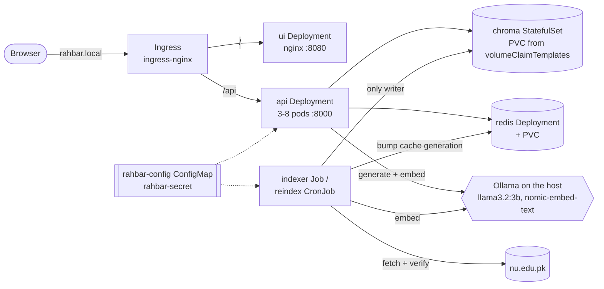

# Architecture

Everything runs in the namespace `rahbar` on minikube (k8s/base, applied through
k8s/overlays/dev). Two paths never share a process: the indexer Job writes the index, and
the api only reads it (ADR 0001).

## Objects

| Object | File | What it is for |
| --- | --- | --- |
| Namespace `rahbar` | k8s/base/namespace.yaml | Everything; nothing goes in `default` |
| ServiceAccounts api, ui, chroma, redis, indexer | k8s/base/serviceaccounts.yaml | One per workload, no token mounted, no Role bound |
| ConfigMap `rahbar-config` | k8s/base/configmap.yaml | Every tunable, each with the measurement it came from |
| Secret `rahbar-secret` | created by `make secret` | `LLM_API_KEY` for `hosted` mode; k8s/base/secret.placeholder.yaml shows its shape and is never applied |
| StatefulSet `chroma` + Service | k8s/base/chroma.yaml | The vector store, chromadb/chroma:1.0.12 |
| Deployment `redis` + PVC + Service | k8s/base/redis.yaml | The semantic cache with AOF persistence (ADR 0003) |
| Deployment `api` + Service + HPA | k8s/base/api.yaml | The question path, 3-8 replicas |
| Deployment `ui` + Service | k8s/base/ui.yaml | The chat page, static nginx |
| Job `indexer`, CronJob `reindex` | k8s/base/indexer.yaml | The only writer to Chroma; weekly re-index |
| Ingress `rahbar` | k8s/base/ingress.yaml | `/` to ui, `/api` to api, host rahbar.local |
| NetworkPolicy x7 | k8s/base/networkpolicy.yaml | Deny by default, then the allow list below |

All four Services are ClusterIP. Chroma and Redis are never NodePort or LoadBalancer.

## Why Chroma is a StatefulSet

Chroma keeps the index on disk under `/data`. A Deployment would treat its pods as
interchangeable and share one PersistentVolumeClaim between them. With
`ReadWriteOnce` storage, a rolling update would start the new pod while the old one still
holds the volume, so the new pod would hang in `ContainerCreating` or, on storage that
allows it, two Chroma processes would write the same files. Scaling a Deployment to two
replicas would do the same thing on purpose.

A StatefulSet gives the pod a stable identity (`chroma-0`) and its own claim from
`volumeClaimTemplates` (`data-chroma-0`, k8s/base/chroma.yaml:59-66). The claim outlives
the pod: when `chroma-0` is deleted or rescheduled, the replacement is created only after
the old pod is gone and reattaches the same volume, so the index survives without a
re-index. We checked this during the probe experiment
(docs/evidence/probes-chroma-down.txt): `chroma` was scaled to 0 and back twice, and each
new `chroma-0` reattached `data-chroma-0` with all 803 chunks and the pin metadata
(`embed_model: nomic-embed-text, dimension: 768`) intact. Redis, which also
holds state, is a single-replica Deployment with `strategy: Recreate` and a named PVC
(k8s/base/redis.yaml), because its data is a cache that can be rebuilt, and the brief
asks for exactly that shape (§4.1).

## Network paths (NetworkPolicy, Calico)

| From | To | Port | Why |
| --- | --- | --- | --- |
| ingress-nginx | ui | 8080 | the page |
| ingress-nginx, ui | api | 8000 | /api |
| api, indexer | chroma | 8000 | read (api), write (indexer) |
| api, indexer | redis | 6379 | cache (api), cache generation bump (indexer) |
| api, indexer | Ollama host 192.168.65.254/32 | 11434 | generation and embeddings |
| indexer | nu.edu.pk 203.124.44.78/32 | 443 | corpus fetch at Job start |
| every pod | kube-dns | 53 UDP, TCP | names |

Everything else is denied in both directions. The ui cannot reach chroma or redis, and
the api cannot reach the internet (docs/evidence/networkpolicy-proof.txt).

## Pod security

Every pod runs as a non-root numeric user with `readOnlyRootFilesystem: true`,
`allowPrivilegeEscalation: false`, all capabilities dropped, the RuntimeDefault seccomp
profile, `automountServiceAccountToken: false` and `enableServiceLinks: false`. Writable
paths are emptyDir volumes (`/tmp` everywhere, `/corpus` for the indexer) or the PVCs.

## Resources

From `kubectl top pods` every 10 s during a real index run and a 40-question burst
(docs/evidence/kubectl-top.txt):

| Container | Measured peak | Requests | Limits | Margin |
| --- | --- | --- | --- | --- |
| indexer | 1659m, 1159Mi (OCR) | 500m, 1280Mi | 2, 1792Mi | memory limit 1.5x peak; CPU throttles, never kills |
| api | 186m at start-up, 6m answering; 129Mi | 100m, 160Mi | 500m, 320Mi | memory limit 2.5x peak |
| chroma | 26m, 107Mi | 50m, 160Mi | 500m, 512Mi | room for the index to grow |
| redis | 9m, 11Mi | 20m, 32Mi | 100m, 128Mi | |
| ui | 2m, 2Mi | 5m, 16Mi | 50m, 32Mi | |

The memory requests sum to about 2 GiB with three api pods, inside the 5 GB node.

## Rollouts and probes

The api uses the three probes exactly as §4.3 gives them: startup and liveness on
`/healthz`, which touches nothing, and readiness on `/readyz`, which checks Chroma, a
non-empty collection, the embedding pin and Redis. Rolling updates use `maxSurge: 1`,
`maxUnavailable: 0`, a 5-second `preStop` sleep and a 30-second grace period, so a pod
leaves the Service before it stops accepting connections. Evidence:
docs/evidence/rollout-and-endpoints.txt (set image, rollout status, rollout undo) and
docs/evidence/embedding-pin-demo.txt (a pin mismatch leaves the new pod at 0/1 while the
old ones keep serving).

## Images and delivery

Three images, all on pinned bases: `rahbar-api` and `rahbar-indexer` on
python:3.12.16-slim, `rahbar-ui` on nginxinc/nginx-unprivileged:1.30.6-alpine, plus
chromadb/chroma:1.0.12 and redis:7.4.2. Locally `make images` builds them as `:dev` and
loads them into minikube. On a push to main, cd.yml pushes them to Docker Hub as
`docker.io/nuabdulrehman/rahbar-*:<commit SHA>` and deploys that SHA to a kind cluster, so the
answer to "what is running?" is one commit id.
